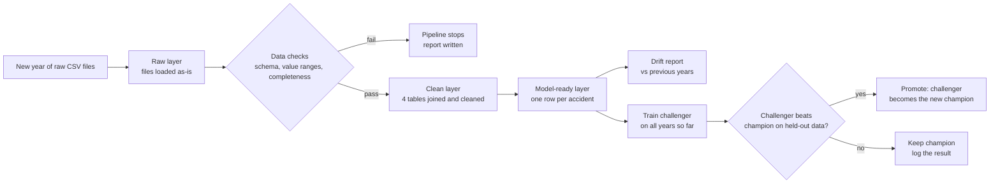
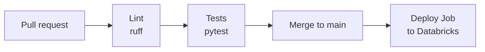

# SafeRoad-MLOps

**A machine learning pipeline that relearns every year, built on Databricks.**

SafeRoad-MLOps predicts how serious a road accident is from its circumstances, using France's national road-accident data. The model is the easy part. The project is really about what happens around it: what a production ML system has to do when new data keeps arriving. Each year of data is replayed as a new production batch. Every batch is validated, checked for drift, used to train a challenger model, and that challenger replaces the current model only if it does measurably better.

> **Status:** in progress. Sections marked _TODO_ are filled in as the work advances.

---

## Why this project

Most ML projects stop when the model scores well in a notebook. In real teams, the hard questions come afterwards:

- **Reproducibility:** can someone else rerun the training and get the same model?
- **Traceability:** which data, code and parameters produced the model that's in production right now?
- **Data quality:** what happens when next year's data comes in with a renamed column or a new category?
- **Safe updates:** how do you replace a model without ever making things worse?

SafeRoad-MLOps answers these questions on real, imperfect public data, with tools used in industry: Databricks, Delta Lake, MLflow, pytest and GitHub Actions.

---

## Data

**Source:** the national file of road-traffic injury accidents ("Fichier BAAC"), published by ONISR, France's national road-safety observatory, on [data.gouv.fr](https://www.data.gouv.fr/fr/datasets/base-de-donnees-accidents-corporels-de-la-circulation/).

- One set of **4 CSV files per year**:
  - `caracteristiques`: when, where and in what conditions the accident happened.
  - `lieux`: the road and its surroundings.
  - `vehicules`: the vehicles involved.
  - `usagers`: the people involved, including how badly each person was injured.
- The files are joined on the accident identifier (`Num_Acc`).
- **Scope:** years **2019–2024**. Restricting to recent years keeps one consistent coding system.

**Prediction target:** an accident is labelled **"serious"** if at least one person involved was killed or hospitalised, and "not serious" otherwise. This is built from the per-person injury field (`grav`) in the `usagers` file. Check the exact codes in ONISR's variable guide before implementing.

**Example features:** light conditions, urban or rural area, intersection type, weather, collision type, road category, speed limit, road surface, time of day, vehicle categories, and the age of the people involved.

> ⚠️ Read ONISR's official guide to the variables before writing any code. Data published over several years is never perfectly consistent: separators, file encodings or column names can change. Catching exactly that kind of problem is what the data-quality checks below are for.

---

## How the pipeline works

Each year is processed as if it were a new batch arriving in production:



**The yearly loop in practice:**

1. Train the first champion on **2019–2020**.
2. For each following year (2021, 2022, ...):
   1. Load the year into the raw layer.
   2. Run the data checks. The year is rejected if any check fails.
   3. Produce a drift report comparing it with the years before.
   4. Train a challenger on every year so far.
   5. Evaluate the champion and the challenger on the same held-out data.
   6. Promote the challenger only if the promotion rule is met.

---

## Architecture

| Component | Tool | Role |
|---|---|---|
| Platform | **Databricks Free Edition** | Notebooks, scheduled Jobs, Unity Catalog |
| Storage | **Delta Lake** (Unity Catalog tables) | Raw, clean and model-ready layers; Delta's version history lets you go back to any earlier state |
| Processing | **PySpark** | Ingesting the files, joining the 4 tables, feature engineering |
| Experiment tracking | **MLflow** | Parameters, metrics, plots and artefacts for every training run |
| Model registry | **MLflow Model Registry** (in Unity Catalog) | Model versions, with `@champion` and `@challenger` aliases |
| Tests | **pytest** plus custom data checks | Tests on code, data and models |
| CI/CD | **GitHub Actions** | Linting and tests on every pull request; deployment of the Databricks Job |
| Packaging | Python package (`src/` layout) | The same code runs locally, in CI and on Databricks |

**Databricks Free Edition limits to plan for:**
- Compute is serverless only.
- Outbound internet access is restricted. Download the CSV files to your machine first, then upload them to a Unity Catalog **Volume**.
- Jobs run at most 5 tasks at the same time, which is plenty for this project.

---

## Data-quality checks

Every yearly batch must pass these checks before it's used for anything:

| Check | Example rule |
|---|---|
| **Schema** | All expected columns are present, with the expected types |
| **Keys** | `Num_Acc` is unique in `caracteristiques`, and every vehicle and person links to an existing accident |
| **Allowed values** | Coded fields only contain codes listed in ONISR's guide |
| **Ranges** | Speed limits, birth years and times of day fall within plausible values |
| **Completeness** | The share of missing values per column stays below a set threshold |
| **Volume** | The yearly row count is within ±X% of the previous years |

A failed check **stops the pipeline** and writes a readable report. Bad data never reaches the model.

---

## Models

| Model | Purpose |
|---|---|
| **Logistic regression** | An interpretable statistical baseline |
| **Gradient boosting** (XGBoost) | The main candidate model |

**Metrics.** Serious accidents are the minority class, so plain accuracy would be misleading. The pipeline uses:
- **PR-AUC**, the main metric for comparing models;
- **recall on serious accidents** at a fixed precision;
- the **Brier score**, to check whether predicted probabilities are well calibrated.

---

## Champion / challenger promotion rule

A challenger becomes the new champion only if **all** of these hold:

1. It beats the champion's PR-AUC on the same held-out data by at least a set margin (e.g. +0.5 point).
2. Its recall on serious accidents is not lower than the champion's.
3. Its calibration (Brier score) does not get worse beyond a tolerance.

Every decision, whether promoted or rejected, is logged in MLflow along with the reason. That gives a full audit trail of which model was in production, when, and why.

---

## Drift monitoring

For each new year, the drift report compares:

- the **distribution of each feature** against previous years, using the Population Stability Index (PSI);
- the **share of serious accidents** (target drift);
- the **champion's performance** on the new year, before any retraining.

The reports are saved as MLflow artefacts, so drift can be followed year after year.

---

## Testing strategy

| Level | What is tested | Example |
|---|---|---|
| **Code** | Feature-engineering and transformation functions | `test_time_of_day_bucketing`, `test_join_preserves_accidents` |
| **Data** | The quality checks above, run on small sample files | `test_rejects_missing_column`, `test_rejects_unknown_codes` |
| **Model** | Minimum performance and expected behaviour | Beats a trivial baseline; the training pipeline runs end to end on a sample; predictions are probabilities between 0 and 1 |

Tests run locally on small sample files (no Databricks needed) and in CI on every pull request.

---

## CI/CD



- **On every pull request:** linting and the full test suite.
- **On merge to `main`:** the Databricks Job definition is deployed, using Databricks Asset Bundles if supported on Free Edition, otherwise the Databricks CLI.
- **Secrets:** the Databricks access token is stored in GitHub Actions secrets and never committed.

---

## Repository structure

```
saferoad-mlops/
├── src/saferoad/
│   ├── ingest.py          # raw layer: load the yearly CSV files
│   ├── validate.py        # data-quality checks
│   ├── transform.py       # clean and model-ready layers: joins, features, target
│   ├── train.py           # model training with MLflow tracking
│   ├── evaluate.py        # metrics and the promotion rule
│   ├── drift.py           # PSI and drift reports
│   └── pipeline.py        # yearly replay loop
├── tests/
│   ├── data/              # small sample CSV files for tests
│   ├── test_validate.py
│   ├── test_transform.py
│   └── test_model.py
├── notebooks/             # exploration only, no production logic
├── jobs/                  # Databricks Job / bundle definition
├── .github/workflows/ci.yml
├── pyproject.toml
└── README.md
```

---

## How to run

_TODO: complete once the pipeline runs end to end._

```bash
# Local: install and run the tests
pip install -e ".[dev]"
pytest

# Databricks: upload the CSV files to the Unity Catalog Volume,
# then run the yearly replay job
databricks jobs run-now --job-id <JOB_ID>
```

---

## Results

_TODO: fill in with real numbers._

| Year added | Data checks | Drift (max PSI) | Champion PR-AUC | Challenger PR-AUC | Decision |
|---|---|---|---|---|---|
| 2021 | | | | | |
| 2022 | | | | | |
| 2023 | | | | | |
| 2024 | | | | | |

---

## Roadmap (about 6 days)

| Day | Goal |
|---|---|
| 1 | Databricks setup, GitHub repo, CSV files uploaded to a Volume, raw tables for 2019–2024 |
| 2 | Joins, cleaning, target and features; data-quality checks |
| 3 | Baseline and gradient-boosting models, MLflow tracking |
| 4 | Model registry with champion/challenger aliases; yearly replay loop and promotion rule |
| 5 | Drift reports; pytest suite; GitHub Actions CI; scheduled Databricks Job |
| 6 | README results, architecture diagram, cleanup |

**Next steps after the first version:** automated deployment with Databricks Asset Bundles, a monitoring dashboard, and a model-explanation report (feature importance per year).

---

## Limitations

- The data only covers accidents recorded by the police, so it isn't a complete picture of road risk.
- Some personal fields are hidden in the public files to protect privacy.
- The model is a learning and engineering exercise, not a tool for real-world road-safety decisions.

---

_Data: ONISR, published on data.gouv.fr under France's open licence. Check the dataset page for licence and citation details._
